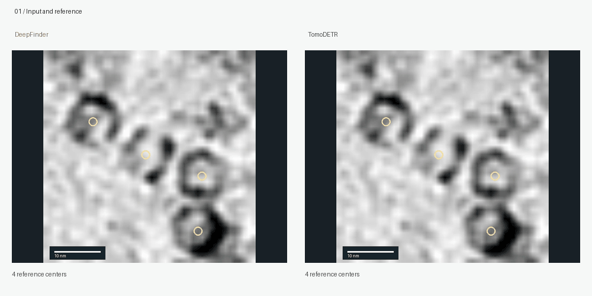

# TomoDETR

### Point-Set Prediction with Cross-Window Refinement for Cryo-ET Particle Localization

[**Project page & interactive comparisons**](https://jackbo04.github.io/TomoDETR-release/) · [Getting started](docs/GETTING_STARTED.md) · [Data preparation](docs/DATA.md) · [MIT license](LICENSE)

**TomoDETR finds particle centers directly in 3D cryo-electron tomograms.** A local set detector predicts particle coordinates and classes from point annotations. The **Cross-Window Query Refiner (CWQR)** then lets nearby candidates from overlapping windows exchange information, jointly refining their coordinates and class scores before final selection.

**Paper:** arXiv submission in progress. The paper link and citation will be added when available.

<p align="center"><a href="https://jackbo04.github.io/TomoDETR-release/#crowded"></a></p>

*Four neighboring particles merge into one DeepFinder semantic foreground; native mean-shift returns two inaccurate centers. TomoDETR localizes all four. [Play the recorded stages →](https://jackbo04.github.io/TomoDETR-release/#crowded)*

**[Inspect the native baseline pipelines →](https://jackbo04.github.io/TomoDETR-release/#native-traces)** Explore real DeepFinder mean-shift, DeepETPicker MP-NMS, and OCTOPI watershed intermediates in a separate crowded region.

## Why TomoDETR?

- **Predict the target directly.** Continuous particle centers and classes, supervised by point annotations without dense particle masks.
- **Learn from overlapping views.** Repeated predictions contain complementary localization information; CWQR refines them before final selection.
- **A compact two-stage model.** A six-class detector has 6,983,784 parameters; CWQR adds 468,506. The manuscript reports 2.9% additional measured inference time for CWQR.
- **An end-to-end workflow.** Dataset configurations, detector training, candidate export, CWQR training, validation calibration, and prediction are included.

## Results

Reported results from the current manuscript. Scores are percentages; improvements are percentage points.

| Method | CZII weighted F₄ | SHREC2021 F₁ | DeePiCt VPP pooled F₁ | DeePiCt Defocus pooled F₁ |
|---|---:|---:|---:|---:|
| DeepETPicker | 60.13 | 92.06 ± 0.71 | 81.47 ± 5.73 | 80.04 ± 1.40 |
| DeepFinder | 51.65 | 79.59 ± 2.52 | 77.80 ± 8.24 | 77.25 ± 1.85 |
| OCTOPI | 66.61 | 85.40 ± 0.62 | 72.60 ± 17.75 | 72.33 ± 4.01 |
| TomoDETR w/o CWQR | 70.07 ± 0.40 | 86.99 ± 2.31 | 80.16 ± 5.25 | 79.08 ± 0.90 |
| **TomoDETR** | **72.92 ± 0.45** | **93.08 ± 0.16** | **82.34 ± 5.91** | **81.67 ± 0.56** |
| CWQR paired gain | +2.85 ± 0.18 | +6.09 ± 2.18 | +2.18 ± 0.73 | +2.58 ± 0.45 |

CZII and SHREC results use three training seeds; DeePiCt uses three fixed splits. ± denotes sample standard deviation. External CZII baselines are single reproduced runs. Each dataset or imaging condition uses its own trained model.

Under a shared backbone, training data, and update budget on CZII:

| Formulation | Weighted F₄ |
|---|---:|
| Dense Gaussian heatmap + center extraction | 67.77 ± 0.54 |
| Direct point-set prediction | 70.07 ± 0.40 |
| Paired improvement | **+2.30 ± 0.15** |

## Quick start

Requires Python 3.10+ and PyTorch 2.3+. Install a suitable PyTorch build for your device, then:

```bash
git clone https://github.com/JackBo04/TomoDETR-release.git
cd TomoDETR-release
python -m pip install -e '.[test]'
python -m tomodetr --help
python -m pytest -q
```

Prepare a JSON manifest with tomogram paths and point annotations (`z,y,x,class_id`). See [data preparation](docs/DATA.md) for coordinate conversion and dataset-specific formats.

```bash
python -m tomodetr train-detector --config configs/czii.yaml \
  --manifest data.json --output outputs/detector --device cuda:0

python -m tomodetr export --config configs/czii.yaml \
  --manifest data.json --detector outputs/detector/latest.pt \
  --output cache --device cuda:0

python -m tomodetr train-cwqr --config configs/czii.yaml \
  --manifest data.json --cache cache --output outputs/cwqr --device cuda:0

python -m tomodetr calibrate --config configs/czii.yaml \
  --manifest data.json --cache cache --cwqr outputs/cwqr/latest.pt \
  --output outputs/calibration --device cuda:0

python -m tomodetr predict --config configs/czii.yaml \
  --manifest data.json --cache cache --cwqr outputs/cwqr/latest.pt \
  --calibration outputs/calibration/calibration.json \
  --output outputs/predictions --device cuda:0
```

Use `configs/shrec.yaml` or `configs/deepict.yaml` for the other datasets. Omit `--cwqr` from calibration and prediction for the without-CWQR endpoint. Full instructions: [Getting started](docs/GETTING_STARTED.md).

## Repository guide

| Path | Contents |
|---|---|
| `tomodetr/` | Local 3D detector, CWQR, losses, data handling, metrics, and CLI |
| `configs/` | CZII, SHREC2021, and DeePiCt configurations |
| `examples/` | Manifest examples, coordinate conversion, synthetic smoke workflow |
| `tests/` | Model, evaluation, calibration, and prediction checks |
| `docs/` | Training instructions, data formats, implementation mapping, validation |
| `site/` | Static GitHub Pages site and interactive qualitative comparisons |
| `deployment/` | Pages publishing script and optional Actions workflow templates |

The release contains source code and qualitative figure excerpts; pretrained checkpoints and full datasets are not bundled. Implementation and historical training details are documented in [Paper alignment](docs/PAPER_ALIGNMENT.md), with checks in [Validation](docs/VALIDATION.md).

## Project page

The site uses plain HTML, CSS, and JavaScript, with no build step. Preview locally:

```bash
python -m http.server 8000 --directory site
```

Open `http://localhost:8000`. GitHub Pages serves the `gh-pages` branch. After committing updates on `main`, run `bash deployment/publish-pages.sh` to publish the site. Optional Actions templates are included in `deployment/` for accounts with workflow permissions. The page presents the formulation, accuracy, inference speed, and recorded crowded-region stages. [Stage provenance](site/assets/stages/PROVENANCE.md) explains the scientific displays.

## License

Code and documentation are released under the [MIT License](LICENSE). Scientific image assets retain their original dataset terms; see [asset provenance](site/assets/PROVENANCE.md).
